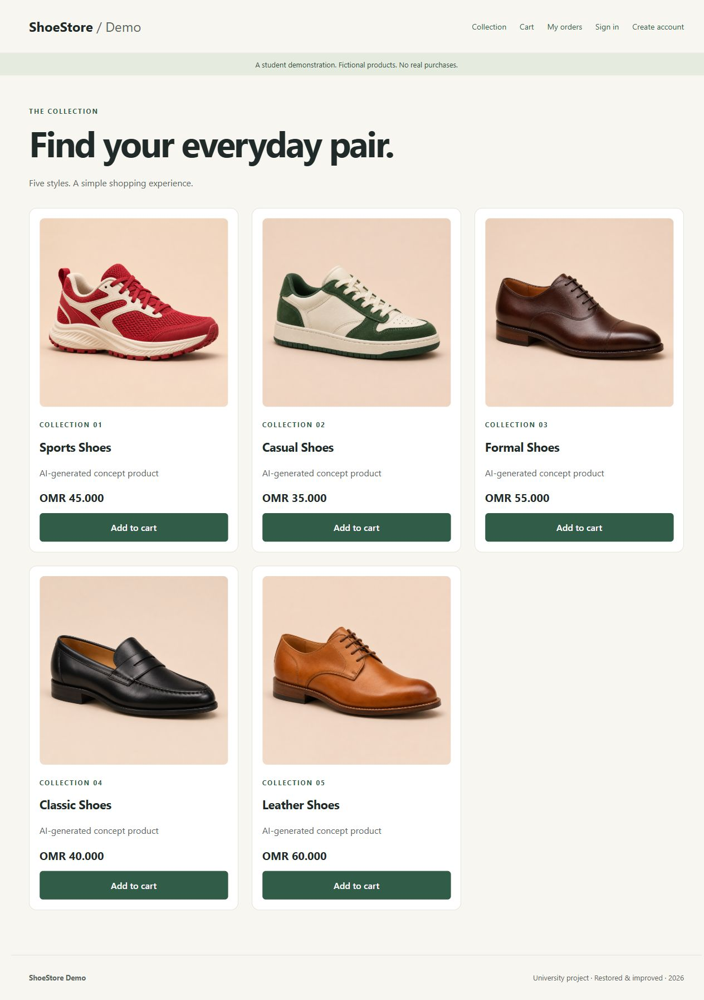

# ShoeStore Demo

A restored university ASP.NET Web Forms / C# shoe-store demonstration with a complete account, cart and demo-order journey. Fictional products; no real purchases, shipping or payment processing.

## Run locally on Windows
Requires .NET Framework 4.8 and IIS Express, or Visual Studio with ASP.NET / .NET Framework web development tools. No NuGet restore or SQL Server is needed.

1. Extract the complete ZIP to a writable folder.
2. In PowerShell run `./Build.ps1`, then `./Start-Local.ps1`.
3. Open `http://localhost:58241/`.

Alternatively open `ShoeStoreDemo.sln` in Visual Studio and run with IIS Express. Set Home.aspx as the start page if needed. Internal source paths and namespace retain WebApplication5 for continuity with the university source.

If Windows blocks a script, review it and unblock it in file properties, or use Visual Studio. These scripts do not change your execution policy.

## Try it
Register with fictional details: a username of 3–30 letters, digits or underscores, an address such as learner@example.test, and a unique password of 12–128 characters. There is no preset admin account.

Browse five fictional products, add items to the cart, sign in and place a demo order. My orders shows only the signed-in account's orders. Sign out when finished. Remember Me controls authentication-cookie persistence.

## Changes
- Updated name, responsive layout, keyboard focus and associated form labels.
- Replaced inherited product photos with five AI-generated, unbranded catalog images and a matching homepage hero.
- Working registration, sign-in and sign-out; duplicate-username checks.
- PBKDF2-HMAC-SHA256 password derivation with random salts and 600,000 iterations.
- Server-side totals in Omani rials and a limit of ten items per product.
- Persistent local orders, account-isolated history and duplicate-order tokens.
- Protected checkout/history routes and ASP.NET anti-forgery view-state checks.
- Local XML store replaces the unavailable original SQL database.

## Data and limits
Accounts and orders are saved in WebApplication5/App_Data/demo-store.xml, excluded from version control. Use fictional email and customer names. The cart expires with its session. Original database files, reports, personal information, photos, unused libraries and compiled files are excluded from the ZIP.

This edition targets one local application process. It is not a production store or a multi-server persistence system. There is no admin role, inventory reservation, password reset, email delivery or payment integration. Sign-in throttling is a short session-based delay, not distributed abuse prevention. Before public hosting, use HTTPS and secure cookies, a proper database, production identity/account recovery and operational controls. Never publish runtime account data.

## Validation
- C# compilation and ASP.NET precompilation passed.
- 17 domain tests passed: registration validation, password verification, duplicates, price calculation, invalid carts, persistence, order deduplication and account isolation.
- 10 hosted ASP.NET flow checks passed: anonymous redirects, registration postback, adding products, cookie authentication, preserving the cart across login, checkout, clearing the cart, order history, logout and access after logout.
- Pages rendered through ASP.NET without server errors.

Tests ran against an isolated temporary copy; the deliverable has no test accounts or orders. The live local IIS Express site was subsequently verified in the browser, including all five loaded product images and responsive layout. The earlier launch attempt from the restricted preparation process failed; launch the provided helper from Windows if a local server is needed.

## Authorship and publication
This is a restored and improved university team project. Preserve team credit and confirm permission for shared work before publication. No open-source license has been assigned. Publication of this cleaned project has been authorized by the owner. No deployment or LinkedIn post is included.

References: [ASP.NET forms authentication](https://learn.microsoft.com/en-us/dotnet/api/system.web.security.formsauthentication.setauthcookie?view=netframework-4.8.1), [PBKDF2 constructors](https://learn.microsoft.com/en-us/dotnet/api/system.security.cryptography.rfc2898derivebytes.-ctor?view=netframework-4.8.1).

Run ./Test.ps1 to reproduce the 27 checks in an isolated .test-work directory (ignored by Git).

## Image provenance
The five PNG files in WebApplication5/Images were generated for this project using OpenAI image generation. They depict fictional, unbranded concept products, not actual merchandise. No inherited product photographs are included.
